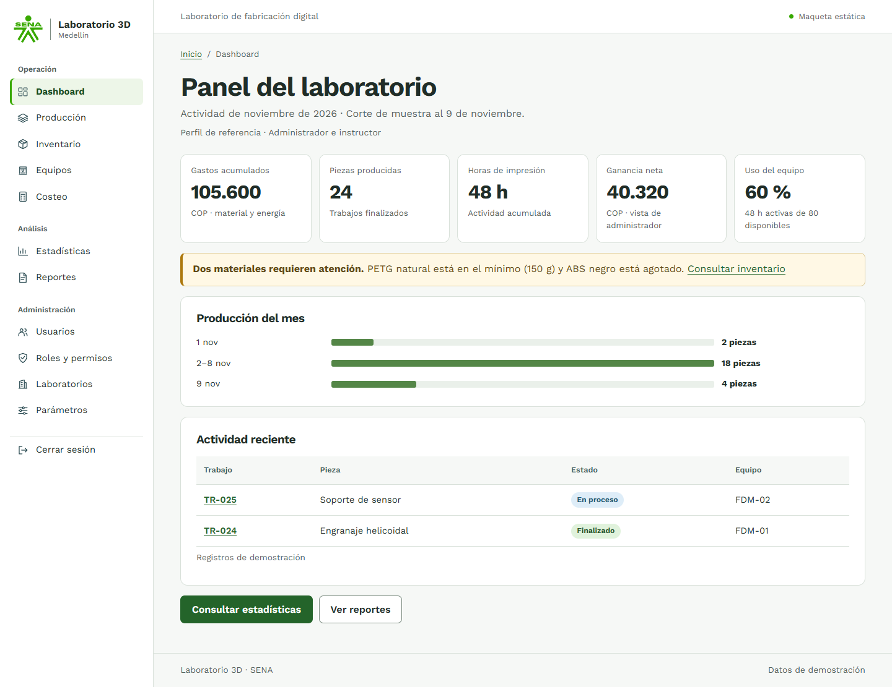
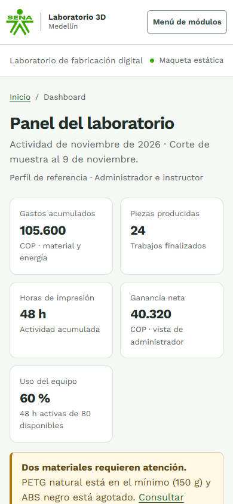
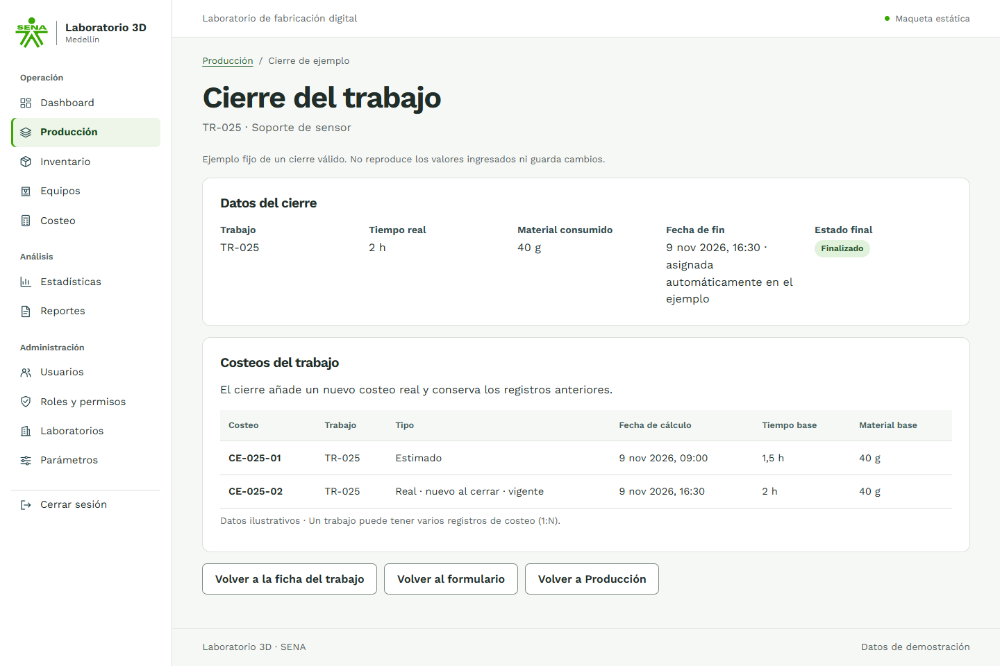
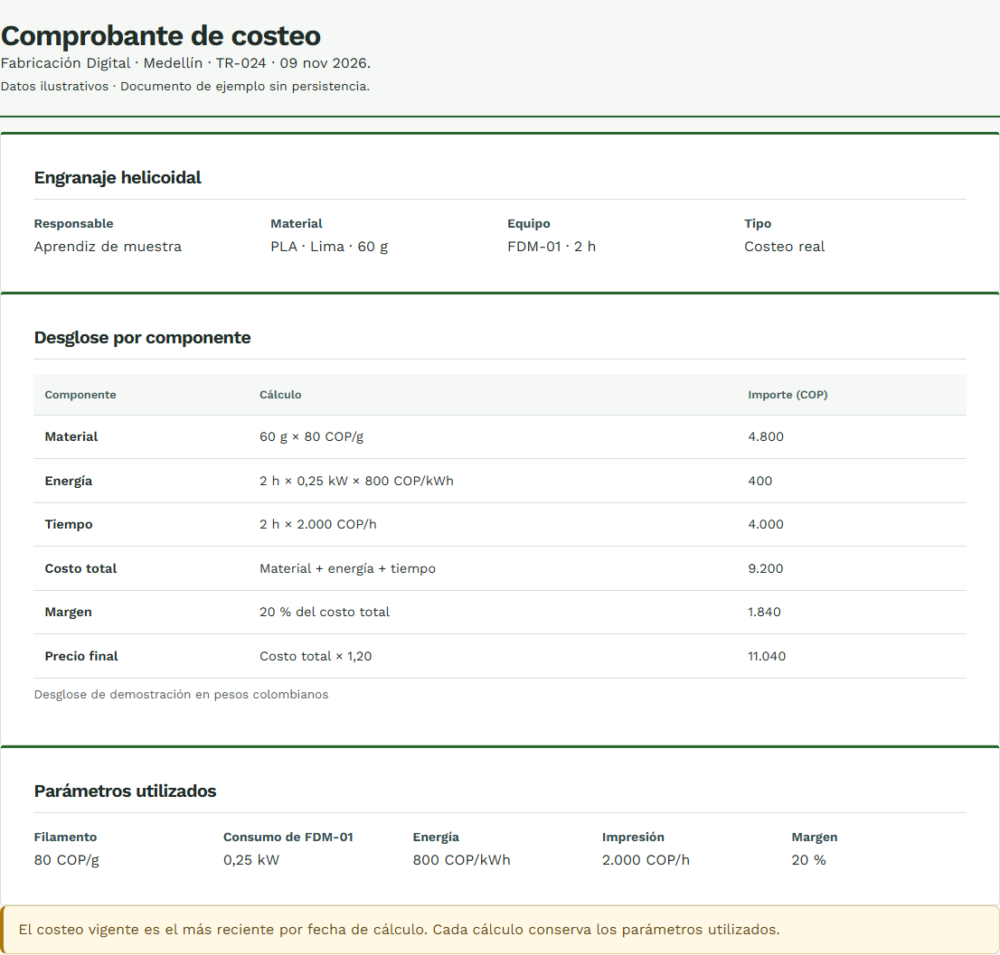
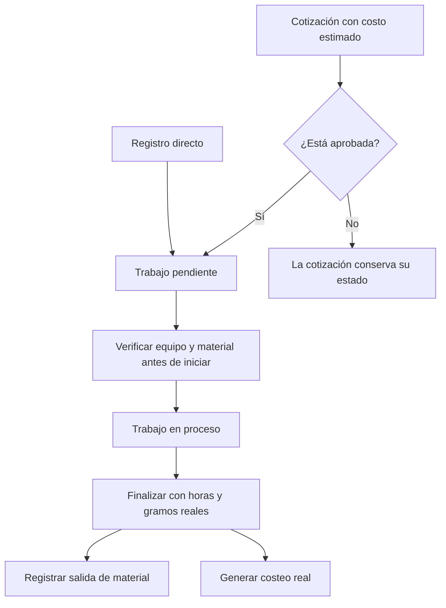
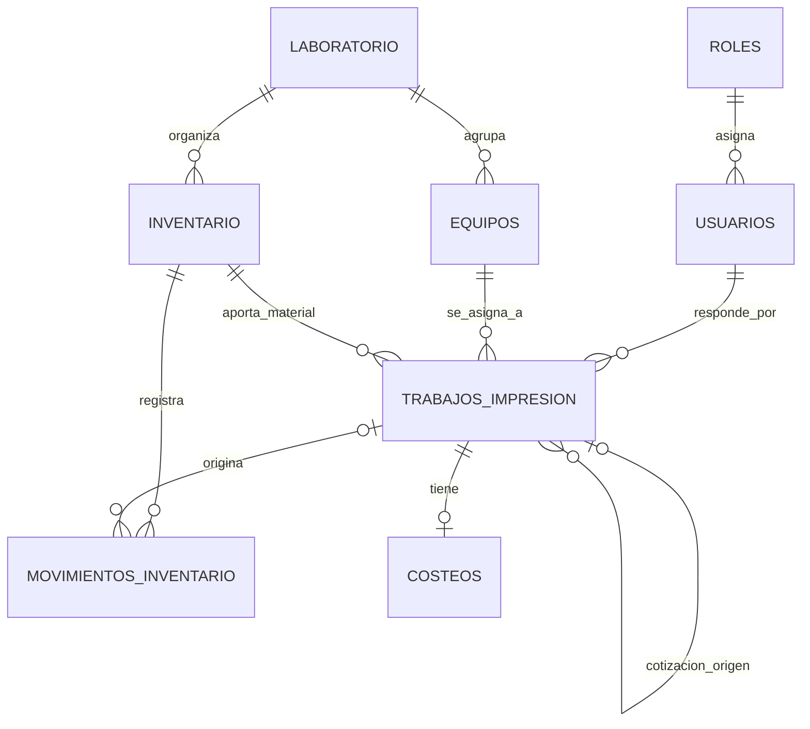

# Sistema de producción y costeo de impresión 3D

El laboratorio SENA necesita dar seguimiento a cada impresión, desde la cotización hasta el consumo de material y el costo real de la pieza. Este proyecto académico de **Análisis y Desarrollo de Software (ADSO)** reúne el análisis de ese proceso, el diseño de datos y una maqueta web para recorrerlo.

**64 pantallas HTML de demostración · 11 procesos documentados · Modelo relacional en MySQL**

[Abrir la maqueta](#abrir-la-maqueta) · [Análisis y documentación](#análisis-y-documentación) · [Guía de desarrollo](#guía-de-desarrollo) · [Base de datos](#base-de-datos)



## Mi aporte

Lideré la coordinación del equipo en SENA ADSO y participé en la definición de los requisitos, los casos de uso y el modelado relacional. Desarrollé la maqueta modular con HTML, CSS, Bootstrap y JavaScript para la carga de plantillas compartidas. También gestioné el trabajo en Git mediante ramas y revisiones por pull request. Los artefactos de análisis y diseño reúnen el trabajo del equipo.

## Abrir la maqueta

1. Abre la raíz del proyecto en Visual Studio Code e inicia **Live Server** con **Go Live**.
2. Entra al [acceso local](http://127.0.0.1:5500/features/acceso/pages/index.html). La configuración del repositorio sirve `Frontend/` en el puerto `5500`. Con el servidor iniciado, **F5** abre la misma pantalla en Chrome.
3. Para entrar al Dashboard, escribe un correo de ejemplo como `demo@example.test` y cualquier texto en el campo de contraseña. La pantalla valida el formato y permite recorrer la maqueta. Usa datos ficticios.

La maqueta funciona sin compilación, instalación de paquetes ni conexión a MySQL. Abre las pantallas por HTTP para que el navegador pueda cargar las plantillas con `fetch`.

### Recorrido de demostración

| Qué explorar | Dónde empezar | Qué se puede observar |
| --- | --- | --- |
| Operación del laboratorio | [Dashboard](Frontend/features/dashboard/pages/index.html) | Indicadores y alertas de stock, con menú adaptable a móvil. |
| Cotización y conversión | [Cotizaciones](Frontend/features/costeo/pages/cotizaciones.html) | Estados de ejemplo, revisión y conversión de una cotización aprobada en trabajo pendiente. |
| Cierre de un trabajo | [Producción](Frontend/features/produccion/pages/index.html) | En el trabajo en proceso, abre **Actualizar estado**, elige **Finalizado** y prueba con **2 h** y **40 g**. El formulario lleva al [cierre ilustrativo](Frontend/features/produccion/pages/cierre-ejemplo.html). |
| Desglose económico | [Comprobante de costeo](Frontend/features/costeo/pages/detalle.html#comprobante) | Material, energía, tiempo y margen en un comprobante integrado. |
| Seguimiento | [Estadísticas](Frontend/features/estadisticas/pages/index.html) y [Reportes](Frontend/features/reportes/pages/index.html) | Vistas por período, gráficos estáticos y formatos de consulta e impresión. |

<details>
<summary>Ver el Dashboard en móvil</summary>



</details>

<details>
<summary>Ver el cierre de Producción</summary>



</details>

<details>
<summary>Ver el comprobante de costeo</summary>



</details>

## Análisis y documentación

El trabajo de análisis parte del alcance académico, describe los procesos del laboratorio y traduce sus reglas en requisitos y casos de uso. El prototipo sirve de referencia para la interfaz.

| Artefacto | Para qué consultarlo |
| --- | --- |
| [Ficha de proyecto](documents/Ficha%20de%20Proyecto%20ADSO_2026%20.docx) | Problema, objetivos, alcance académico y funcionalidad prevista. |
| [Ficha de caracterización](documents/ficha_caracterizacion_proceso.docx) | Entradas, actividades, salidas e indicadores de cada proceso. |
| [Mapa de procesos](documents/Mapa%20De%20Procesos_V2.pdf) | Relación entre procesos estratégicos, misionales y de apoyo. |
| [Matriz de requerimientos](documents/Matriz_Requerimientos_Impresion3D.xlsx) | Requisitos funcionales, reglas de negocio y requisitos de información. |
| [Casos de uso](documents/Caso%20de%20uso%20-%20Impresion3d.eap) | Actores e interacciones modeladas en Enterprise Architect. |
| [Referencia del prototipo](documents/Mockup_prototipo.docx) | Acceso al prototipo que orienta la interfaz. |

### Flujo de negocio

Una cotización aprobada puede convertirse una vez en un trabajo pendiente. También se puede registrar un trabajo directamente. Al comenzar se comprueba la disponibilidad del equipo y del material. La salida de inventario se genera al finalizar, con los gramos reales. El flujo muestra el comportamiento previsto por la matriz que la maqueta ilustra con escenarios fijos.



## Guía de desarrollo

### Organización del repositorio

```text
Frontend/
  features/<modulo>/pages/  Pantallas y datos ilustrativos
  shared/templates/        Bloques HTML compartidos
  shared/scripts/          Cargador de plantillas
  shared/styles/           Estilos base, componentes y vistas
  shared/assets/           Imágenes y fuentes locales
  vendor/bootstrap/        CSS de Bootstrap
documents/                 Análisis, requisitos y recursos visuales
Database/                  Script SQL y modelo de Workbench
```

Los 11 procesos son **Usuarios, Roles y permisos, Parámetros, Laboratorios, Equipos, Inventario, Producción, Costeo, Estadísticas, Dashboard y Reportes**. La carpeta `acceso` agrupa las pantallas de autenticación y recuperación del proceso de Usuarios.

### Cómo se arma una página

Cada pantalla declara `data-layout` y `data-modulo` en el `body` y mantiene su contenido dentro de `main#contenido`. El [cargador compartido](Frontend/shared/scripts/layout.js) usa esos atributos para insertar el lateral de acceso, o bien el menú, encabezado y pie de gestión desde [las cuatro plantillas](Frontend/shared/templates/). El atributo de módulo también determina el enlace activo. Si la carga falla, queda visible el contenido principal con un aviso.

| Cambio | Lugar |
| --- | --- |
| Una pantalla, formulario o dato de ejemplo | `Frontend/features/<modulo>/pages/` |
| Menú, encabezado, pie o lateral de acceso | [Plantillas compartidas](Frontend/shared/templates/) |
| Variables, colores y fuente general | [base.css](Frontend/shared/styles/base.css) y [fonts](Frontend/shared/assets/fonts/) |
| Botones, formularios y tablas | [components.css](Frontend/shared/styles/components.css) y [components](Frontend/shared/styles/components/) |
| Diseño, informes e impresión | [Estilos compartidos](Frontend/shared/styles/) |

### Añadir o modificar una pantalla

1. Consulta la matriz y los casos de uso para comprobar el rol, los campos y el flujo. Usa el SQL para verificar nombres y relaciones.
2. Parte de una pantalla del mismo módulo. Conserva `main#contenido`, el enlace de salto, los atributos del `body` y el cargador con `defer`. Cambia el título, las migas y el contenido propio.
3. Reutiliza estilos y componentes. Para mover o editar el menú, conserva `input`, `label` y `nav` como hermanos en ese orden. Los selectores de foco y apertura móvil dependen de esa estructura.
4. Comprueba enlaces, formularios, teclado, escritorio y móvil con Live Server. Revisa la vista de impresión si modificas informes o comprobantes. Busca el identificador de cualquier dato ilustrativo que cambies porque puede aparecer en varias pantallas.
5. Para integrar cambios, trabaja en una rama y presenta una pull request a `master`.

### Formularios y datos de ejemplo

- Los formularios muestran validaciones nativas y navegan entre ejemplos. En Inventario y Producción, CSS muestra la acción o el formulario del tipo o estado seleccionado.
- Las listas de Usuarios y Roles enlazan a formularios comunes con datos de muestra. La consulta de Roles conserva una matriz por perfil y las pantallas de Estadísticas tienen muestras diarias, semanales y mensuales.
- `TR-024` y `COT-017` están relacionados entre las fichas de Producción y Costeo. `TR-025` ilustra el cierre y el historial de costeos. El Dashboard, Estadísticas y el informe de Producción comparten cifras escritas en sus páginas.
- Los botones de descarga en los informes y comprobantes aparecen deshabilitados. Para ver el formato documental, usa **Imprimir** o **Guardar como PDF** desde el navegador.

## Base de datos

El [script SQL](Database/Impresora_3D.sql) describe el esquema `impresion3d_db` de MySQL. El [modelo de Workbench](Database/modelo_relacional.mwb) permite explorar las entidades y sus relaciones. Se puede consultar el modelo al margen de la maqueta, cuyos datos están escritos en el HTML.

El diagrama resume relaciones declaradas en el SQL. Los catálogos, los parámetros, los permisos y los historiales complementan estas entidades.



**Pendiente de integración.** La matriz (`RI-7.2` y `RN-8.0`) contempla varios costeos por trabajo para conservar el historial. El SQL declara el índice único `uq_costeo_trabajo`, que permite como máximo un costeo por trabajo. Además, `costeos.id_trabajo` está declarado como `INT` y la clave referenciada como `INT UNSIGNED`. Antes de integrar, valida el script en una base de desarrollo y concilia la relación y los tipos con los requisitos.

## Estado del proyecto

| Disponible en la maqueta | Pendiente de integración |
| --- | --- |
| Navegación entre 64 pantallas, diseño adaptable y plantillas reutilizables. | Autenticación, permisos efectivos y persistencia de los datos. |
| Validaciones nativas, escenarios de producción y comprobantes de muestra. | Conversión de cotizaciones, movimientos de stock y cálculo de costos con datos reales. |
| Indicadores ilustrativos, informes y vista de impresión. | Consultas por filtros, consolidación de estadísticas y generación automática de archivos. |

Si contribuyes al proyecto, consulta los [lineamientos del repositorio](AGENTS.md) antes de incorporar dependencias, lógica adicional, un backend o cambios al SQL.
